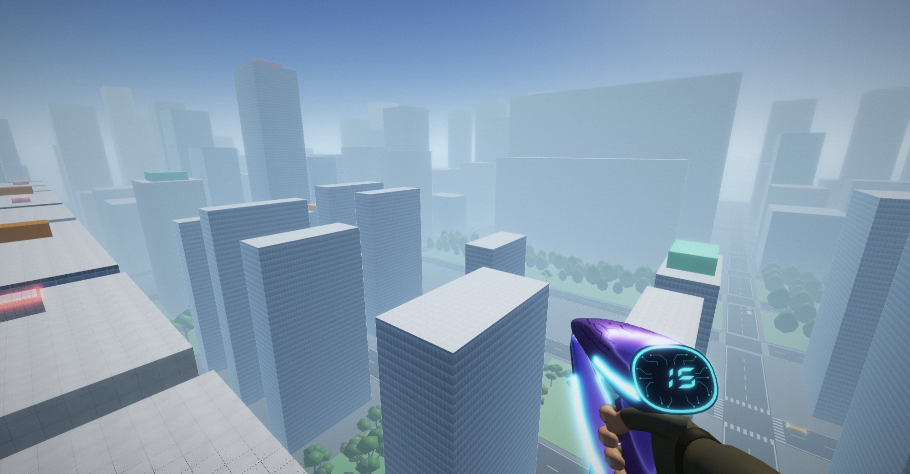
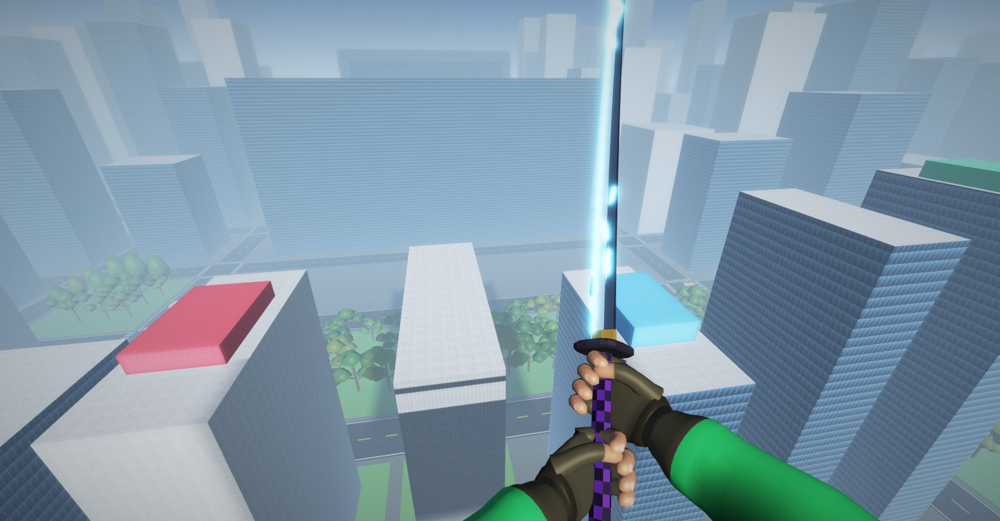
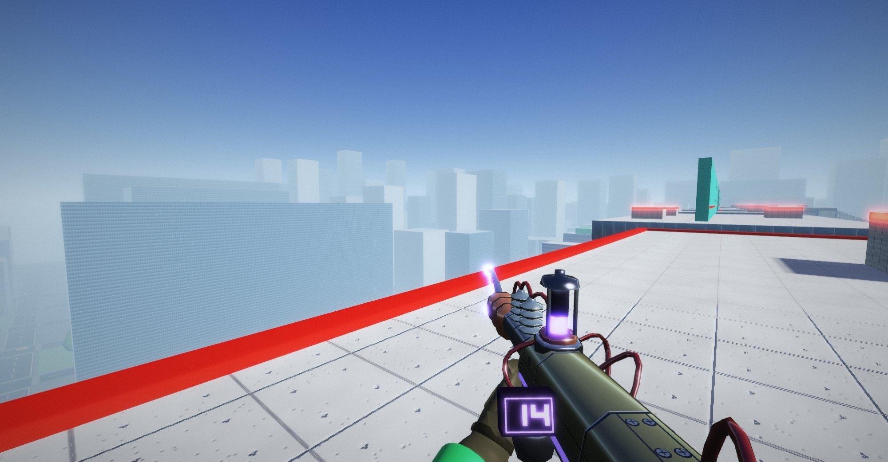
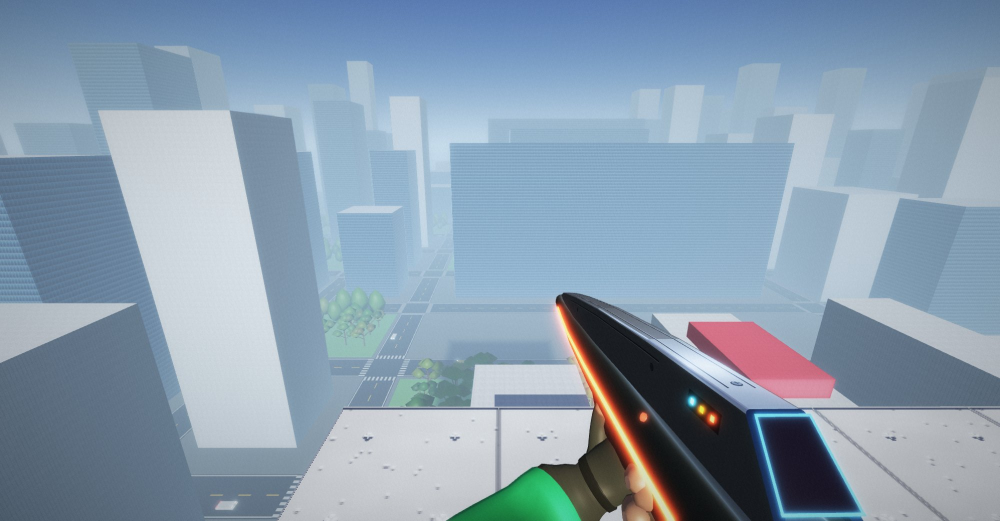

# tiny-fps

[](https://www.npmjs.com/package/@korial29/tiny-fps)
[](https://www.npmjs.com/package/@korial29/tiny-fps)
[](https://bundlephobia.com/package/@korial29/tiny-fps)
[](https://github.com/korial29/tiny-fps/actions/workflows/ci.yml)
[](package.json)
[](LICENSE)
[](https://korial29.github.io/tiny-fps/)

**▶ Play it now: https://korial29.github.io/tiny-fps/**

A tiny multiplayer first-person game for the browser, written in TypeScript with raw WebGL2, no game library and no runtime dependency. It is becoming an open-air capture-the-flag between two teams of players on rooftops, inspired by Mirror's Edge: parkour movement and no CPU enemies. Today two teams play capture the flag on Highline, a symmetric rooftop map, or on Tranquility, a moon base in a crater, with the parkour moves, a tackle, a plasma gun, an electric katana, a rail gun and a laser rifle ([`docs/PLAN.md`](docs/PLAN.md), [`docs/WEAPON.md`](docs/WEAPON.md)). Everything is generated in code: geometry, textures, lights. There are no images, fonts or assets to serve.

It started as a co-op shooter inspired by carlini's [Yet Another Doom Clone](https://github.com/carlini/js13k2019-yet-another-doom-clone) (js13k 2019). Only the ideas were reused, not the code. The renderer, the netcode and the sound come from that first game.





|                                                                                                                                                                                |                                                                                                                                                 |
| ------------------------------------------------------------------------------------------------------------------------------------------------------------------------------ | ----------------------------------------------------------------------------------------------------------------------------------------------- |
|  |  |

## Framework-agnostic, light to add

`tinyFps()` mounts the game into any element, inside its own Shadow DOM: React, Vue, Angular, Svelte or a plain page, nothing leaks in or out. The game draws everything on one WebGL2 canvas that fills the container.

| Entry                       | What it is                                                             | Size (gzip) |
| --------------------------- | ---------------------------------------------------------------------- | ----------- |
| `@korial29/tiny-fps`        | The game client: rendering, lights and shadows, input, prediction, HUD | ~80 KB      |
| `@korial29/tiny-fps/local`  | Same-browser multiplayer, no server: the host runs in a tab            | ~15.5 KB    |
| `@korial29/tiny-fps/server` | Node WebSocket server (needs `ws`)                                     | Node only   |

CI checks the budgets (144 KB and 32 KB) on every pull request.

## Live demo

https://korial29.github.io/tiny-fps/

1. Open the page, pick a name and play: you have the rooftop to yourself.
2. To play with someone on one machine, open it in a second tab of the same browser and join with another name: the tabs play together, with no server.
3. To play across devices, pick the server mode and give it the URL of a running `tiny-fps-server`.

---

## Installation

```sh
npm install @korial29/tiny-fps
```

The unscoped name `tiny-fps` belongs to another package. The server entry also needs [`ws`](https://github.com/websockets/ws), an optional peer dependency:

```sh
npm install ws
```

---

## Basic usage

### Tabs of the same browser, no server

```ts
import { tinyFps } from '@korial29/tiny-fps';
import { localSocket } from '@korial29/tiny-fps/local';

const game = tinyFps(document.getElementById('game')!, {
  name: 'Ana',
  socket: localSocket('my-room'),
});
```

Every tab that opens `localSocket('my-room')` joins the same game over a [`BroadcastChannel`](https://developer.mozilla.org/en-US/docs/Web/API/BroadcastChannel). One tab hosts the game, elected with [`navigator.locks`](https://developer.mozilla.org/en-US/docs/Web/API/Web_Locks_API); when it closes, another tab takes over with a fresh game. `navigator.locks` needs a secure context: on `http://` from a LAN address, each tab plays alone.

### Across devices, with a WebSocket server

```ts
// server.ts (Node)
import { serve } from '@korial29/tiny-fps/server';

const stop = serve({ port: 8787 }); // or serve({ server: existingHttpServer })
```

```ts
// in the browser
import { tinyFps } from '@korial29/tiny-fps';

tinyFps(document.getElementById('game')!, {
  name: 'Ana',
  url: 'wss://your-host.example/my-room',
});
```

Each URL path is its own room: `/my-room` and `/other` are two separate games. A ready-made server ships as a command:

```sh
PORT=8787 npx tiny-fps-server
```

`MAP=tranquility` starts a new room on the moon map (the default is `highline`). In local mode the tab that hosts the room starts it on its client's `map` option, which the demo's Map menu sets.

### The host picks the map

The player in the room the longest is its **host**; when they leave, the next oldest player takes over. Press Esc in a game: the maps sit in the Game panel of the title screen. The host's are buttons, and the one they pick is played from the next match on, never in the middle of one (or from the next join when the room empties). Everyone else sees the maps read-only, with the host's name and pick, and the end screen says the map of the next match. The server checks that the pick comes from the host: anyone else's is ignored.

The client follows the room: when the roster names another map, it builds that map on the same connection, so players keep their id, their team and the host role. The `map` option is only the map built until the roster comes.

### Sizing

The canvas fills its container, at any size and ratio. Give the container a size:

```css
#game {
  width: 100vw;
  height: 100dvh;
}
```

---

## API

### `tinyFps(container, options)`

Mounts the game and joins. Returns `{ on, players, destroy }`.

| Option   | Type         | Description                                                                                  |
| -------- | ------------ | -------------------------------------------------------------------------------------------- |
| `name`   | `string`     | Player name shown above your head (16 characters max). A taken name gets a suffix (`Bob 2`). |
| `url`    | `string`     | WebSocket URL, room in the path. Ignored when `socket` is given.                             |
| `socket` | `SocketLike` | Any WebSocket-like object, e.g. `localSocket('room')`.                                       |

Without WebGL2 the game stays connected and says so on screen.

### `on(event, callback)`

| Event    | When                                                     |
| -------- | -------------------------------------------------------- |
| `open`   | Connected.                                               |
| `close`  | Disconnected.                                            |
| `roster` | A player joined or left; read the list with `players()`. |

```ts
game.on('roster', () => console.log(game.players().map(p => p.name)));
```

### `players()`

Everyone in the room, you included: `{ id, name, team, color }[]`. `team` is 0 (red) or 1 (blue), and `color` is the team's CSS colour.

### `destroy()`

Leaves the game, stops rendering, releases the pointer and removes the game's DOM. Safe to call twice.

### `localSocket(room, rules?)`: `@korial29/tiny-fps/local`

A same-browser socket for `tinyFps`. `rules` apply to the game the tab hosts, so pass the same ones from every tab.

### `serve({ port | server, rules? })`: `@korial29/tiny-fps/server`

Starts the WebSocket server, one room per URL path, and returns an async `stop()`. `rules` apply to every room.

### `SocketLike`

The subset of `WebSocket` the client uses: `binaryType`, `onopen`, `onclose`, `onmessage`, `send(data)` and `close()`. A real `WebSocket` and `localSocket()` both fit, and so does a relay over a transport you already have. Text frames are JSON, and binary frames (inputs, snapshots) must arrive as an `ArrayBuffer` of exactly their bytes.

### Rules

| Rule         | Default | Description                                                                       |
| ------------ | ------- | --------------------------------------------------------------------------------- |
| `maxPlayers` | `16`    | Players in a room; the next ones are told the room is full.                       |
| `scoreLimit` | `3`     | Captures that end a match at once.                                                |
| `timeLimit`  | `480`   | Seconds a match lasts. The team with more captures wins, a level score is a draw. |

---

## Controls

| Action | Keys                                                                                |
| ------ | ----------------------------------------------------------------------------------- |
| Look   | Mouse (click the game to lock the pointer, Esc to release it)                       |
| Move   | WASD, or the arrow keys                                                             |
| Sprint | Shift, with forward: the top speed builds over about a second                       |
| Jump   | Space. Press it again in the air for a second jump                                  |
| Dash   | A move key pressed twice quickly: a short burst that way, once a second             |
| Crouch | C. At sprint speed it is a slide, low enough to go under a 1.2 m slot               |
| Fire   | Left button: click to fire the gun, hold to charge it; click to cut with the katana |
| Weapon | 1 the gun, 2 the katana, 3 the rail gun, 4 the laser rifle, or the wheel            |
| Reload | R: a new battery in the gun or the rifle, a new capsule on the rail gun (also dry)  |
| Mute   | M (remembered)                                                                      |

Facing a ledge between 1.2 and 2.4 m above your feet in the air, you take hold of it: forward or Space climbs, back or C lets go, and Space looking away jumps off it. Jumping while running next to a wall, up to half a metre away and not more than about 50 degrees off it, starts a wall-run along its side (about a second, hold forward, Space kicks off). Ctrl is not used, since Ctrl+W closes the tab.

The katana's cut follows the move key held: left or right cuts down on a diagonal from that side, forward thrusts, otherwise it slashes down. Held, the button stops the cut at the top of its wind-up and charges it; let go after a quarter of a second, the rest of the cut is slower, wider, 2 health harder and half a metre longer. A double click turns the cut into its special: the thrust into a lunge (it spends the dash), the cut across into a heavy diagonal cut that throws an arc of energy 15 m ahead (it hurts and knocks the foe down, and a carrier drops the flag), the slash into a leap and a blow down before landing. Two cuts that strike at the same time face to face lock the blades, as in Jedi Outcast: both click as fast as they can, and the first 8 clicks ahead throws the other back for 3 health; holding a side or back key for 0.4 s steps out of the lock.

Keys are read by their position (`KeyboardEvent.code`), so on an AZERTY keyboard WASD is ZQSD with nothing to set.

---

## How a game plays

The game is the movement and a capture the flag on top of it, with a tackle, a gun and a katana to stop a carrier ([`docs/PLAN.md`](docs/PLAN.md), [`docs/WEAPON.md`](docs/WEAPON.md)).

- **Teams**: red and blue. A joiner goes to the smaller team (red on a tie), up to 16 players in all. Each team starts on its own tower and wears its colour, name tags included.
- **Capture the flag**: touch the enemy flag, at its base or where it was dropped, to take it, and carry it to your own base while your own flag is there: that is a capture, and the flag goes home. Touch your own dropped flag to send it home at once; left alone it goes home after 10 seconds. A carrier who falls off the roofs or leaves drops it where he last stood. A tackled carrier drops it too, and it lies there for 2 seconds: nobody can send it home, and the carrier's teammates can grab it. There is a ring of light on each base, a marker toward each flag (and toward your base while you carry), a banner for each event and a sound for a take, a drop, a return and a capture.
- **A match** ends at 3 captures or after 8 minutes, then everyone sees the result and each player's captures and returns for 10 seconds, and a new match starts with everyone back at their spawn, on the map the host picked.
- **The map**: Highline, 94 by 240 m under an open sky, the same for both teams (the blue half is the mirror of the red one). Each team holds a 26 m tower with its flag and eight spawns. Three routes lead to the other tower, and they meet at the plaza in the middle. The **Spine** (west, 26 m) is the fast one, about 25 s by sprint: an 11 m gap that takes a dash or a double jump, a 17 m viaduct along a wall that takes a wall-run and a dash, a beam over the plaza. **Midtown** (centre, 19 to 21 m) is roofs, short gaps and ledges to grab, about 36 s. The **Lowline** (east, 14.5 m) is stairs, short gaps and a sign to slide under, about 39 s, and needs no special move. A miss costs time: roofs under the gaps and ladders of ledges lead back up, and only a fall into the street puts you back at your tower.
- **Tranquility**, the moon map: an arena of 160 by 280 m in the middle of a crater 600 by 720 m across, under a black sky with the Earth and the stars, in a hard low sun. Gravity is half the Earth's, so a jump floats twice as high and twice as long, and everyone wears a space helmet with a glowing visor. Each team has a round dome with its flag in front, a landing pad with its shuttle, two modules joined by tubes, light masts and rovers. A rille cuts the middle: a bridge, a long jump on the west side, stepping stones on the east. Outside the arena the regolith rolls away in hills and craters to a wall nobody climbs past: the Bowl with a wrecked lander at its bottom, a long ridge to the east, an antenna array on a hill, a boulder field, and seven jump ramps marked by orange lamps. The arena's field is no longer flat: mounds up to 2.6 m roll between the bases and the rille and each half has a hollow 2 m deep. The rille wanders, its lips following a meander with bights up to 6.5 m under a rim of broken rock, its walls dropping in strata to a dark bottom; two mounds on each side ramp up to its lip, so a rover with a long run-up flies the 16 m gap. The boulders are irregular rocks drawn first, with what you collide with fitted inside each. Thirty-one craters pit the crater floor, their rims outlined by a drawn band; three hold a pit 18 m deep, where a rover that drives in stays and its crew climbs out by the steps on the east wall. The regolith's texture does not repeat: the shader fetches its tile twice at offsets drawn from a noise and blends them, and darkens the slopes. Its tone varies by noise computed in the shader and, with distance, the tile fades to its mean colour, so far hills carry shading and no pattern. The ground is one lattice of heights for the physics and the drawing (`relief.ts`), so what you see is what you stand on. The bases are dressed from outside like a ship's hull: twelve dark spines up each dome to a collar round its aerial, traces of light up every other one, angled panel cuts between them, hatches and vents, round portholes, a dish and whip aerials on the module roofs, sensors and lamps over the airlocks, strips of light round each dome's foot and door, and lights in the ground leading to the doors. Each base can be walked into: the dome holds a hall 40 m across under a 10.5 m roof, entered by a door facing the flag, with a mezzanine 3.5 m up along its walls (a health pack on its north balcony), stairs facing the door and crates for cover; two tubes run from the hall to the modules, each with an airlock to the outside, and the tube tops and module roofs are still walked on. Two rovers are parked at each base: E gets you in (the wheel first, else the seat beside it) and out. The rover goes where its driver looks, from a camera behind it: W and S are the throttle and the brake, Space the handbrake that swings the tail round, and above a jog the tyres let go and it drifts. It rides on four long, soft springs, flies close to two seconds off a ramp in the half gravity and levels out to land on its wheels. The driver's own weapons are put away and he cannot touch a flag, but the rover carries a laser on each side: holding the left button fires green bolts from both, seven salvos a second, that cross 50 m ahead where he looks and graze like the laser rifle's; the rider keeps his weapons and may carry one; a rover at speed runs enemies over. It is an open two-seat buggy of white panels and gold foil on a bare tube frame, with fenders in its team's colour, headlights and a trail of dust. Players and rovers pass through rovers, and nothing damages one.
- **Weapons**: each team's armoury is a plinth 1.5 m high past its flag, in sight of the spawns, with a gun rack, a katana rack, a rail gun rack and a laser rifle rack: run and jump up to take them. You spawn with none and carry each once taken. The first time a weapon comes to hand you switch it on, each its own way: the right thumb presses the plasma gun's button and the katana's, the left index the laser rifle's, the left hand turns the rail gun's capsule; it lights up with its sound. Drawn again, or after a swap, it lights up at once.
  - The **plasma gun** holds 60 shots, 15 at a time in a battery in its grip: an empty one, or R, swaps it in 1.3 s, the gun dark until the new one is in: the spent battery falls to the floor, the left hand takes a new one out of a pouch on the hip and puts it in, a pause, a slap of the palm, a jolt and the gun back in aim. A click fires a plasma ball at 40 m/s that bursts on the first wall or enemy it touches, and the view kicks up with each one. Held, the button charges the next ball, with a rising whine and the gun shaking, shown by a gauge under the ammo counter, and letting go fires it: up to 5 shots' worth in one second, which takes 5 health and puts any enemy down.
  - The **electric katana** needs no ammo; its whole blade lights up when it is switched on. A cut takes 2 to 4 health by the cut, reaches 2.2 to 3.2 m, and shocks a foe it does not put down: a short stumble the way the blade goes. A cut that puts a foe down takes off the limb the blade crosses, head, arm or leg, drawn only, with no blood.
  - The **rail gun** is a two-handed Tesla gun with a stock, humming in your hands: hold the button and a bolt of lightning goes out, up to 30 m, for 8 s in all, a glass cell screwed on its top holding a third of it, and two smaller ones along its flanks showing the rest, each lit as high as its charge: an empty one, or R, is thrown off and a new one screwed on in 1.5 s. Fired for 2 s on end it overheats: its insulators glow, its cells flicker red, smoke rises off its coils and it cannot fire for 2 s; its counter stays steady. Each pulse of the arc kicks it, and it shakes harder as it heats. An enemy it touches loses 1 health at once, then 1 a second while it holds him and for 3 seconds after, and walks no faster than 3 m/s meanwhile. One it kills is disintegrated. Rail cells on every route refill a third of it.
  - The **laser rifle**, after Halo's assault rifle, is held in both hands: hold the button and it fires 20 red plasma balls a second, to 60 m, every two hits taking 1 health, drifting a little off the crosshair. Each bursts in a big red splash of sparks with a heavy thud. It carries 240 rounds, 60 at a time in a power cell under its body (R or empty: 1.6 s to swap), its count on a counter on top. Ammo packs refill it too.
- **Health**: 5 points, a plasma hit takes 1, no friendly fire, no regeneration. At 0 a player lies down for 2 seconds, drops a carried flag, loses every weapon and comes back at a team spawn. Health packs give 2 points, ammo packs 20 shots and rail cells a third of the rail gun's lightning; a taken pack is back after 20 seconds, an ammo pack after 10.
- **Moving**: momentum, sprint, dash, double jump, ledge grab and climb, wall-run, slide, coyote time and a jump buffer. The host decides where everyone is. Your own moves show at once (the client predicts them) and are corrected to the host's state, to the bit.
- **The others**: drawn 100 ms in the past, interpolated between snapshots, as runners with one continuous skinned body, a face that blinks and grimaces, a combat stance, a natural gait and every parkour move (leaning well out on a wall-run, the feet on it), in their team colour, with the weapon in their hands.
- **The city**: the street lies far below the roofs, with roads, their markings and traffic out into the haze, and a fog that thickens toward it; parks of tall branched trees in some blocks, and a skyline of towers around the map.
- **Sound**: a synthesiser and a mixer that places sounds left or right by where they come from, and an airy music loop of slow pads and soft bells. Steps, jumps, the deep plasma shot, the katana's draw, swish and zap, the guns' reloads and power-up, hits, pickups and the flag events all have their sound. The sound starts with the click that locks the pointer.
- **Announcer**: a calm voice tells the match starting and its last minute, the flags and the captures from your team's side, two or three takedowns in quick succession, five and ten in a row, a run of plasma shots that mostly hit, and the result. Its 16 lines are generated offline by `scripts/voice.py` and loaded after the first click, apart from the game: about 44 KB in Ogg Opus, or 74 KB in MP3 where the browser cannot decode Opus.

---

## Features

- [x] Multiplayer over WebSocket, or between tabs of one browser with no server
- [x] A brush world under an open sky: roofs at any height, gaps, floating platforms and overhangs, steps, falls back to a spawn; eight procedural materials (brick, tile, lava, stone, metal, wood, moss, grating) with bump mapping and per-material highlights; a sky with a blooming sun, a sun shadow that follows you, daylight from the sky
- [x] Highline, the capture-the-flag map: two towers, three routes at three heights, a plaza, wall-run and dash gaps, ledge ladders and stairs, ways back up after a miss; ROOFTOPS, a parkour course, stays as the test course of the moves
- [x] Tranquility, a moon base in a crater: half gravity, space helmets, domes, a rille to cross, the Earth in a black sky
- [x] Tranquility's crater of 600 by 720 m with relief, a base to walk into, and rovers to drive
- [x] Client-side prediction, exact to the bit, and the other players interpolated
- [x] A per-tick history of the players on the host, for lag compensation
- [x] Daylight: a sky with a blooming sun, a sun shadow that follows you, a light colour per box, haze toward the horizon
- [x] Post-processing: bloom, tone mapping, vignette, film grain, 4x antialiasing
- [x] Parkour moves, predicted exactly: momentum, sprint, dash, double jump, ledge grab and climb, wall-run, slide, coyote time and jump buffer
- [x] Your own body in first person, Mirror's Edge style: arms that pump with the stride, hands on the ledge, legs when you look down; a camera that kicks its field of view, dips on landings, leans into wall-runs; speed lines
- [x] The other players as skinned runners: one continuous skin on a rig, a natural walk, run and sprint with planted feet, and every parkour move
- [x] Four weapons taken at each team's armoury, a plasma gun, an electric katana, a rail gun and a laser rifle: plasma balls, charged shots, three cuts and their specials, a bolt of lightning, a saber lock, a shock, limb cuts, health and ammo packs, all predicted on the client and resolved by the host with lag compensation; magazines and reloads drawn by hand, each weapon switched on its own way
- [x] A city around the roofs: a street far below with traffic and markings to the horizon, a height fog, parks of branched trees and a skyline
- [x] Sound: a jsfxr-style synthesiser for steps, jumps, dashes, landings, grabs, climbs, slides and the wind of speed, placed in stereo; a looped music; M mutes
- [x] A title screen with a menu (the character to play, the mode and the map; the controls), a muted mark, a player count and name tags
- [x] A pixel face over the health, in the spirit of DOOM's (its own look, drawn in code): 42 frames, 5 levels of wounds, glances, a turn toward the side a hit comes from, an ouch, a grin at a new weapon, a rage with the trigger held, a glow carrying the flag, and dead
- [x] Teams and capture the flag: bases with a glowing ring, flags that wave and ride on a carrier's back, a score and a clock, markers toward the flags, banners, an end screen and synth sounds
- [x] An announcer: a calm, generated voice for the match, the flags, takedown runs, the aim and the result
- [x] Shadow DOM, zero runtime dependencies, size-gated in CI

---

## How it works

- **The host is authoritative**: the Node server, or the host tab in local mode. It runs the players on the map.
- **Inputs, not positions**: each client sends one 12-byte input per step at 60 Hz, holding its keys, view angles and the moment it sees the others at. It predicts its own player at once and replays what the host has not acknowledged yet.
- **Snapshots** go out at 30 Hz: a 4-byte head, 58 bytes per player (position, speed, look angles, the movement state and its timers, health, ammo and magazines, weapons and swing), then the match: the captures, the clock, the packs and the two flags, 12 bytes when both are home, then the plasma balls in flight, 10 bytes each, in a compact binary format. The other players are drawn 100 ms in the past, interpolated between snapshots.
- **Rendering**: one WebGL2 shader program and one vertex buffer, up to 16 lights, with up to 4 shadow maps drawn by the same program.

---

## Development

Node 24 (see `.nvmrc`).

```sh
npm install
npm start            # demo with hot reload (Vite)
npm run dev:server   # WebSocket server on :8787
npm test             # Vitest
npm run lint         # Prettier, ESLint, tsc
npm run build        # dist/: client, local, server, types
npm run size         # gzip budgets
```

The demo reads `?name=`, `?mode=local|server` and `?url=` from its URL, which makes testing several players in several tabs quick.

Pull requests need one release label (`release:major`, `release:minor`, `release:patch` or `release:skip`). Merging one into `master` publishes the matching npm release. See [`.github/CI.md`](.github/CI.md).

---

## License

[Apache-2.0](LICENSE)

The announcer's voice is generated with [Kokoro-82M](https://huggingface.co/hexgrad/Kokoro-82M) (Apache-2.0), voice `af_heart`.
