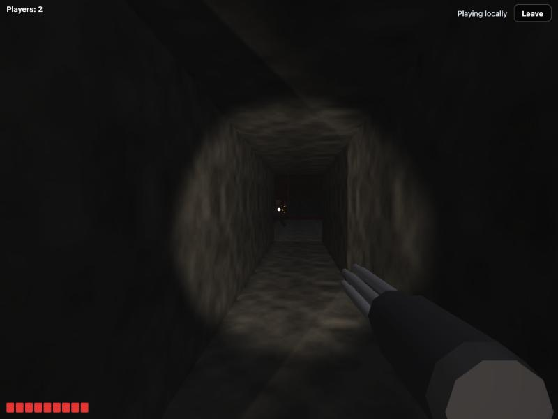
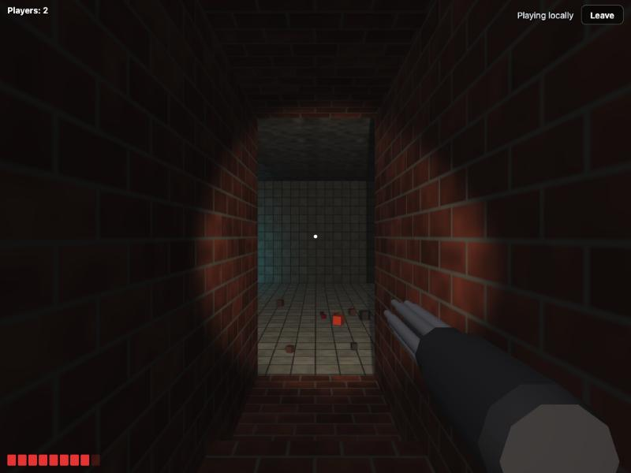
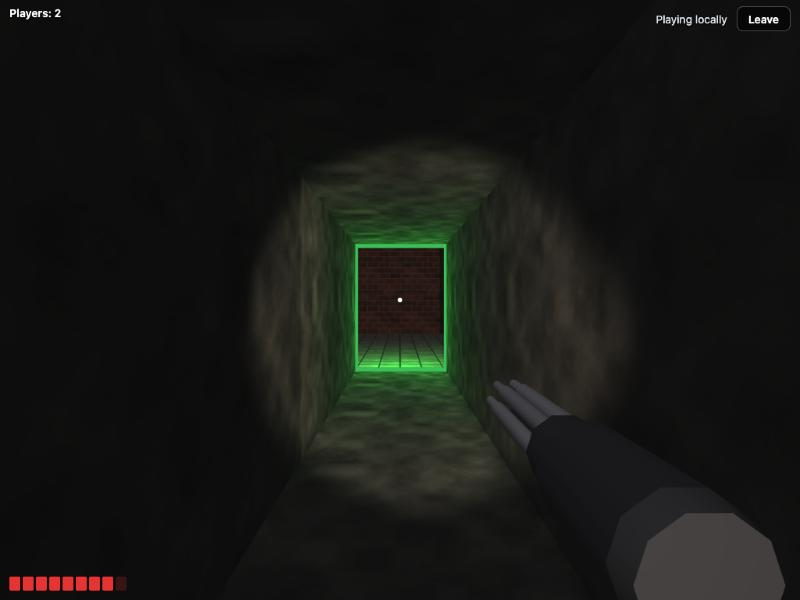

# tiny-fps

[](https://www.npmjs.com/package/@korial29/tiny-fps)
[](https://www.npmjs.com/package/@korial29/tiny-fps)
[](https://bundlephobia.com/package/@korial29/tiny-fps)
[](https://github.com/korial29/tiny-fps/actions/workflows/ci.yml)
[](package.json)
[](LICENSE)
[](https://korial29.github.io/tiny-fps/)

**▶ Play it now: https://korial29.github.io/tiny-fps/**

A tiny multiplayer first-person game for the browser, written in TypeScript with raw WebGL2, no game library and no runtime dependency. It is becoming an open-air capture-the-flag between two teams of players on rooftops, inspired by Mirror's Edge: parkour movement, no weapons, no CPU enemies. The game is being rebuilt step by step toward that ([`docs/PLAN.md`](docs/PLAN.md)): today you run and jump around one empty rooftop with the other players in the room. Everything is generated in code: geometry, textures, lights. There are no images, fonts or assets to serve.

It started as a co-op shooter inspired by carlini's [Yet Another Doom Clone](https://github.com/carlini/js13k2019-yet-another-doom-clone) (js13k 2019). Only the ideas were reused, not the code. The renderer, the netcode and the sound come from that first game; the screenshots below are from it.







## Framework-agnostic, light to add

`tinyFps()` mounts the game into any element, inside its own Shadow DOM: React, Vue, Angular, Svelte or a plain page, nothing leaks in or out. The game draws everything on one WebGL2 canvas that fills the container.

| Entry                       | What it is                                                             | Size (gzip) |
| --------------------------- | ---------------------------------------------------------------------- | ----------- |
| `@korial29/tiny-fps`        | The game client: rendering, lights and shadows, input, prediction, HUD | ~15 KB      |
| `@korial29/tiny-fps/local`  | Same-browser multiplayer, no server: the host runs in a tab            | ~4.3 KB     |
| `@korial29/tiny-fps/server` | Node WebSocket server (needs `ws`)                                     | Node only   |

CI checks the budgets (40 KB and 16 KB) on every pull request.

## Live demo

https://korial29.github.io/tiny-fps/

1. Open the page, pick a name and play: you have the rooftop to yourself.
2. To play with someone on one machine, open it in a second tab of the same browser and join with another name: the tabs play together, with no server.
3. To play across devices, pick the server mode and give it the URL of a running `tiny-fps-server`.

---

## Installation

```sh
npm install @korial29/tiny-fps
```

The unscoped name `tiny-fps` belongs to another package. The server entry also needs [`ws`](https://github.com/websockets/ws), an optional peer dependency:

```sh
npm install ws
```

---

## Basic usage

### Tabs of the same browser, no server

```ts
import { tinyFps } from '@korial29/tiny-fps';
import { localSocket } from '@korial29/tiny-fps/local';

const game = tinyFps(document.getElementById('game')!, {
  name: 'Ana',
  socket: localSocket('my-room'),
});
```

Every tab that opens `localSocket('my-room')` joins the same game over a [`BroadcastChannel`](https://developer.mozilla.org/en-US/docs/Web/API/BroadcastChannel). One tab hosts the game, elected with [`navigator.locks`](https://developer.mozilla.org/en-US/docs/Web/API/Web_Locks_API); when it closes, another tab takes over with a fresh game. `navigator.locks` needs a secure context: on `http://` from a LAN address, each tab plays alone.

### Across devices, with a WebSocket server

```ts
// server.ts (Node)
import { serve } from '@korial29/tiny-fps/server';

const stop = serve({ port: 8787 }); // or serve({ server: existingHttpServer })
```

```ts
// in the browser
import { tinyFps } from '@korial29/tiny-fps';

tinyFps(document.getElementById('game')!, {
  name: 'Ana',
  url: 'wss://your-host.example/my-room',
});
```

Each URL path is its own room: `/my-room` and `/other` are two separate games. A ready-made server ships as a command:

```sh
PORT=8787 npx tiny-fps-server
```

### Sizing

The canvas fills its container, at any size and ratio. Give the container a size:

```css
#game {
  width: 100vw;
  height: 100dvh;
}
```

---

## API

### `tinyFps(container, options)`

Mounts the game and joins. Returns `{ on, players, destroy }`.

| Option   | Type         | Description                                                                                  |
| -------- | ------------ | -------------------------------------------------------------------------------------------- |
| `name`   | `string`     | Player name shown above your head (16 characters max). A taken name gets a suffix (`Bob 2`). |
| `url`    | `string`     | WebSocket URL, room in the path. Ignored when `socket` is given.                             |
| `socket` | `SocketLike` | Any WebSocket-like object, e.g. `localSocket('room')`.                                       |

Without WebGL2 the game stays connected and says so on screen.

### `on(event, callback)`

| Event    | When                                                     |
| -------- | -------------------------------------------------------- |
| `open`   | Connected.                                               |
| `close`  | Disconnected.                                            |
| `roster` | A player joined or left; read the list with `players()`. |

```ts
game.on('roster', () => console.log(game.players().map(p => p.name)));
```

### `players()`

Everyone in the room, you included: `{ id, name, color }[]`. Each player has a colour of their own.

### `destroy()`

Leaves the game, stops rendering, releases the pointer and removes the game's DOM. Safe to call twice.

### `localSocket(room, rules?)`: `@korial29/tiny-fps/local`

A same-browser socket for `tinyFps`. `rules` apply to the game the tab hosts, so pass the same ones from every tab.

### `serve({ port | server, rules? })`: `@korial29/tiny-fps/server`

Starts the WebSocket server, one room per URL path, and returns an async `stop()`. `rules` apply to every room.

### `SocketLike`

The subset of `WebSocket` the client uses: `binaryType`, `onopen`, `onclose`, `onmessage`, `send(data)` and `close()`. A real `WebSocket` and `localSocket()` both fit, and so does a relay over a transport you already have. Text frames are JSON, and binary frames (inputs, snapshots) must arrive as an `ArrayBuffer` of exactly their bytes.

### Rules

| Rule         | Default | Description                                                 |
| ------------ | ------- | ----------------------------------------------------------- |
| `maxPlayers` | `16`    | Players in a room; the next ones are told the room is full. |

---

## Controls

| Action | Keys                                                          |
| ------ | ------------------------------------------------------------- |
| Look   | Mouse (click the game to lock the pointer, Esc to release it) |
| Move   | WASD, or the arrow keys                                       |
| Jump   | Space                                                         |
| Mute   | M (remembered)                                                |

Keys are read by their position (`KeyboardEvent.code`), so on an AZERTY keyboard WASD is ZQSD with nothing to set.

---

## How a game plays

For now the game is the movement and the room; the rules come with the next steps of [`docs/PLAN.md`](docs/PLAN.md).

- **The rooftop**: one 40 × 40 m deck under an open sky, with a parapet round the edge, a crate you can jump onto, a block too tall to climb, and a platform with four steps up to it. Up to 16 players share it, each with a name tag and a colour of their own.
- **Moving**: run, strafe and jump. The host decides where everyone is. Your own moves show at once (the client predicts them) and are corrected to the host's state, to the bit.
- **The others**: drawn 100 ms in the past, interpolated between snapshots, as soldiers with swinging arms and legs. Each carries a flashlight that casts shadows.
- **Sound**: a synthesiser and a mixer that places sounds left or right by where they come from, and a dark music loop. The sound starts with the click that locks the pointer. There are no sound effects yet.
- **Coming**: parkour moves (sprint, double jump, wall-run, ledge grab, slide), a Mirror's Edge look, two teams, flags, a score, and a tackle that makes a carrier drop the flag.

---

## Features

- [x] Multiplayer over WebSocket, or between tabs of one browser with no server
- [x] Doom-style sector maps: steps, pits, low ceilings, balconies, eight procedural materials (brick, tile, lava, stone, metal, wood, moss, grating) with bump mapping and per-material highlights
- [x] The rooftop map: a deck, a parapet, a crate, a block and a platform with steps
- [x] Client-side prediction, exact to the bit, and the other players interpolated
- [x] A per-tick history of the players on the host, for lag compensation
- [x] Flashlights with shadow maps, a light colour per room, a fog colour per map, flickering lava light, dust in the flashlight beam
- [x] Post-processing: bloom, tone mapping, vignette, film grain, 4x antialiasing
- [x] A model for the other players: jointed legs and arms that follow their stride
- [x] Sound: a jsfxr-style synthesiser and a looped music; M mutes
- [x] A title screen with the controls, a muted mark, a player count and name tags
- [x] Shadow DOM, zero runtime dependencies, size-gated in CI

---

## How it works

- **The host is authoritative**: the Node server, or the host tab in local mode. It runs the players on the map.
- **Inputs, not positions**: each client sends one 11-byte input per step at 60 Hz, holding its keys, view angles and the moment it sees the others at. It predicts its own player at once and replays what the host has not acknowledged yet.
- **Snapshots** go out at 30 Hz: a 4-byte head and 24 bytes per player, in a compact binary format. The other players are drawn 100 ms in the past, interpolated between snapshots.
- **Rendering**: one WebGL2 shader program and one vertex buffer, up to 16 lights, with up to 4 shadow maps drawn by the same program.

---

## Development

Node 24 (see `.nvmrc`).

```sh
npm install
npm start            # demo with hot reload (Vite)
npm run dev:server   # WebSocket server on :8787
npm test             # Vitest
npm run lint         # Prettier, ESLint, tsc
npm run build        # dist/: client, local, server, types
npm run size         # gzip budgets
```

The demo reads `?name=`, `?mode=local|server` and `?url=` from its URL, which makes testing several players in several tabs quick.

Pull requests need one release label (`release:major`, `release:minor`, `release:patch` or `release:skip`). Merging one into `master` publishes the matching npm release. See [`.github/CI.md`](.github/CI.md).

---

## License

[Apache-2.0](LICENSE)
